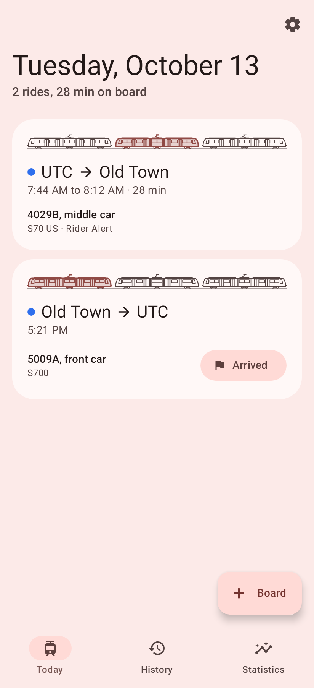
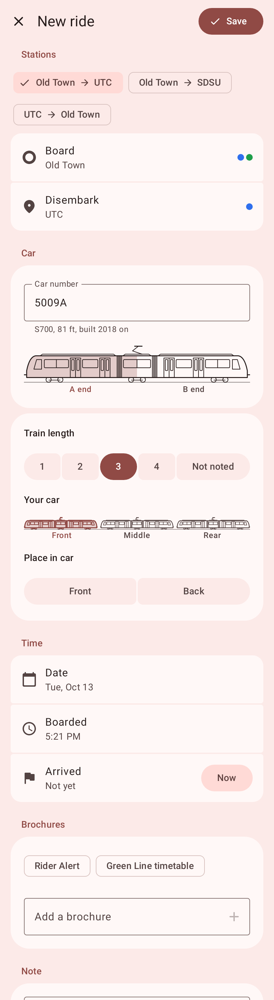
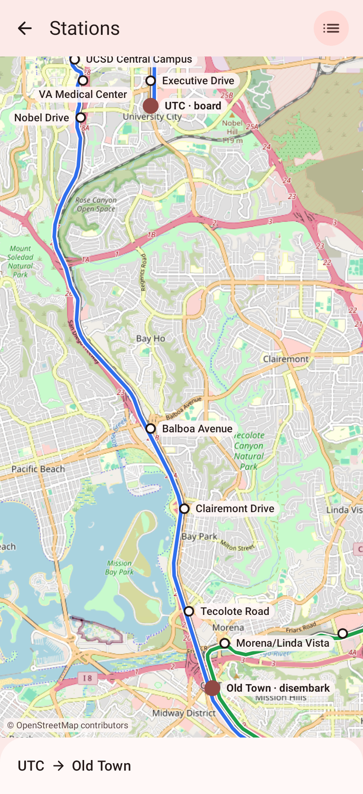
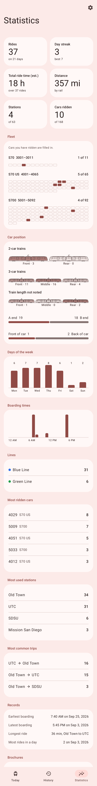

# Trolley Log

Keep a log of every ride you take on the San Diego Trolley from your Android phone.

<p>
  
  
  
  
</p>

## Features

- Log each ride with its car number, where you were in the train, the stations where you boarded and disembarked, and the times.
- See a drawing of the car model (SD100, S70, S70 US, or S700) based on the car number.
- Pick stations from a map of the Trolley lines or from a list.
- Start a new ride from a suggestion for a trip you take often.
- Keep track of the brochures you pick up.
- Look through your statistics, including streaks, time and distance on board, your most-used cars and stations, and a chart of the fleet showing which cars you have ridden.
- Back up and restore your rides, or export and import them as a CSV file.

The map uses OpenStreetMap tiles. An area is downloaded the first time you view it and works offline after that.

Importing a backup or a CSV file adds the rides that are missing from your log. Rides you already have are not changed. A CSV file needs a Date and a Boarded column, and the other columns of an exported file are read when they are there.

## Requirements

- Android 8 or later

## Installation

### From F-Droid

Open [apps.nextcolor.org](https://apps.nextcolor.org/) on your phone and tap **Add to F-Droid**. Then search for Trolley Log in F-Droid and install it.

### From a release

Download the APK from the [latest release](https://github.com/ganyuke/TrolleyLog/releases/latest) and open it on your phone.

## How to build

You need JDK 17 and the Android SDK.

1. Clone this repository: `git clone https://github.com/ganyuke/TrolleyLog`
2. Open the directory: `cd TrolleyLog`
3. Run `./gradlew assembleRelease`. The APK ends up in `app/build/outputs/apk/release/`.

Uninstall the F-Droid version before installing your own build. They're signed with different keys.

`./gradlew test` runs the tests and also saves a picture of every screen to `app/build/screenshots`.

### Updating the station data

The stations, tracks, and scheduled ride times come from the MTS schedule feed. To update them after a service change:

```bash
curl -LO https://www.sdmts.com/google_transit_files/google_transit.zip
python3 scripts/build_network.py google_transit.zip
```
